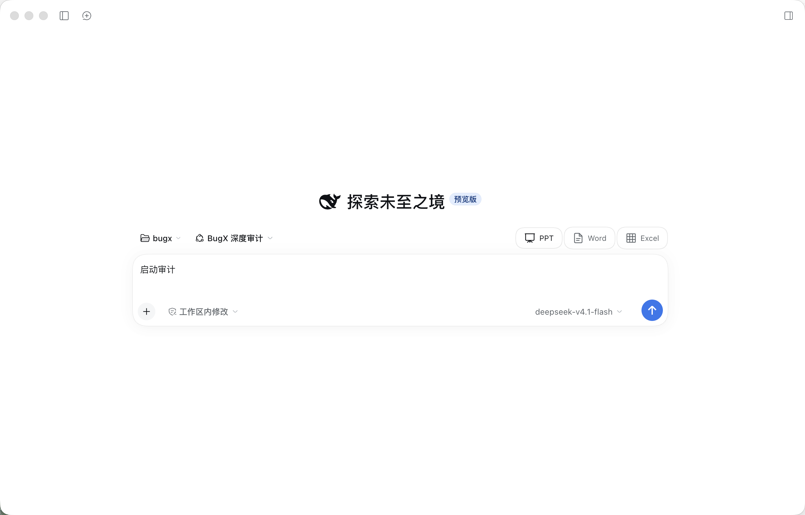

<p align="center">
  
</p>

<h1 align="center">bugx-dsh-plugin</h1>

<p align="center">
  Session-aware MCP bridge and sidebar UI for running <a href="https://bugx.dev">BugX</a> autonomous code review and testing inside DeepSeek Harness (DSH).
</p>

<p align="center">
  
</p>

## What it does

- **Session-aware MCP bridge (`index.js`)**: Keeps BugX tool schemas registered process-wide while spawning an isolated `bugx mcp serve --root <session-cwd>` process per DSH session working directory.
- **Web sidebar UI (`client.js`)**: Adds the BugX brand icon and sidebar tab to the DSH Web interface.

## Prerequisites

This plugin bridges DSH to your local `bugx` CLI (`>=0.1.4`). Install `bugx-cli` first:

```bash
# Python (>=3.11)
pip install bugx-cli

# or Node.js (>=18)
npm install -g bugx-cli
```

Verify installation:

```bash
bugx --version
```

## Install in DSH

```bash
dsh plugin add https://github.com/Bencibr/bugx-dsh-plugin
```

Or install from npm once published:

```bash
dsh plugin add bugx-dsh-plugin
```

## Configuration

The plugin reads its Cordis config schema (`command`, `args`, `schemaCommand`, `schemaArgs`, `role`, `serverName`, `toolCallTimeoutMs`, `failOnStartupError`). Defaults invoke `bugx` from `PATH`.

## License

MIT
